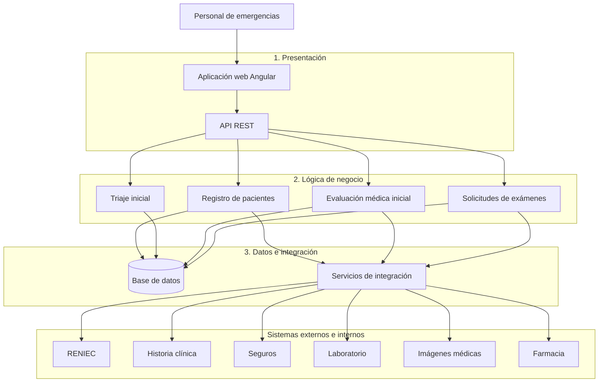

# Arquitectura inicial del sistema SIAE-HRA

## Diagrama de arquitectura

## Descripción

La arquitectura inicial del SIAE-HRA se organiza en tres capas principales:

- **Presentación:** permite al personal de admisión, enfermería y médicos interactuar con el sistema mediante una aplicación web y una API REST.

- **Lógica de negocio:** contiene los módulos principales responsables del registro de pacientes, triaje, evaluación médica inicial y solicitudes de exámenes.

- **Datos e integración:** permite almacenar y consultar información de pacientes y atenciones mediante una base de datos, además de comunicarse con sistemas externos.

El sistema se integrará con servicios de **RENIEC**, **historia clínica electrónica** y **seguros**, así como con los sistemas internos de **laboratorio, diagnóstico por imágenes y farmacia**.

Estas integraciones permitirán consultar información relevante y gestionar solicitudes durante la atención inicial. Para el prototipo académico se podrán utilizar APIs simuladas.