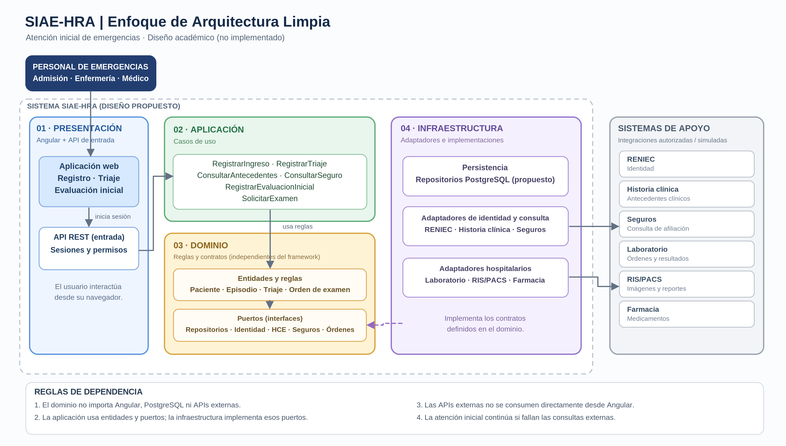

Enfoque arquitectónico del SIAE-HRA
Se utilizará el enfoque de Arquitectura Limpia (Clean Architecture) para separar las responsabilidades del sistema de atención inicial de emergencias.

Descripción
Elemento	Descripción aplicada al SIAE-HRA
Patrón / enfoque arquitectónico	Arquitectura Limpia (Clean Architecture).
Objetivo	Separar la interfaz, los casos de uso, las reglas clínicas y las conexiones con otros sistemas.
¿Qué problema resuelve?	Evita que el registro, triaje y evaluación inicial dependan directamente de Angular, la base de datos o las APIs de RENIEC, historia clínica y seguros.
Capas definidas	Presentación: pantallas del personal. Aplicación: ingreso, triaje, evaluación y solicitudes. Dominio: paciente, episodio, triaje y reglas. Infraestructura: persistencia y adaptadores externos.
Beneficios	Facilita las pruebas, el mantenimiento y el cambio de integraciones sin alterar las reglas principales de atención.

Reglas de dependencia
- El dominio no depende de Angular, PostgreSQL ni de APIs externas.
- Los casos de uso utilizan entidades y contratos definidos hacia el núcleo del sistema.
- Los adaptadores implementan esos contratos; si una API no está disponible, el registro inicial puede continuar con datos provisionales.
Alcance académico: este diagrama representa la arquitectura propuesta. En la primera fase solo se documenta; no implica que las integraciones hospitalarias estén implementadas ni autorizadas.

## Diagrama de Arquitectura Limpia

