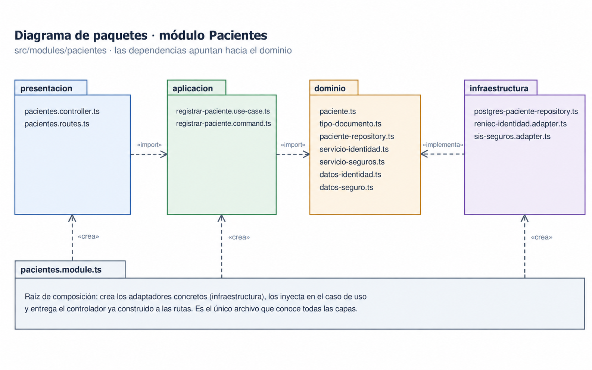
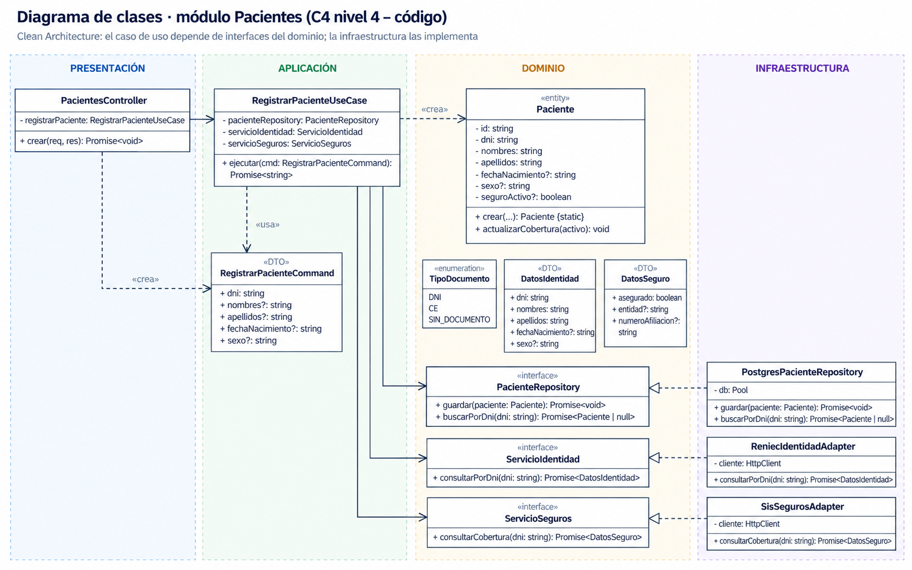
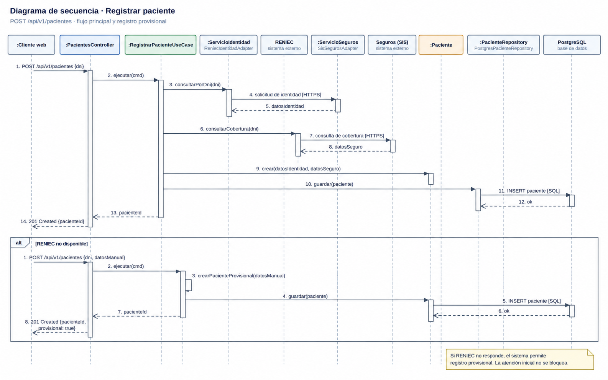

# Diseño interno de módulos

**Proyecto:** SIAE-HRA — Sistema Integrado de Atención de Emergencias del Hospital Regional de Ayacucho  
**Backend propuesto:** Node.js + TypeScript + Express  
**Módulo de referencia:** Pacientes  
**Enfoque arquitectónico:** Clean Architecture dentro de un monolito modular  
**Nivel C4:** 4 – Código  
**Versión:** 1.0

## 1. Propósito

Este documento describe cómo se organiza el código dentro del módulo **Pacientes** del SIAE-HRA.

Tiene tres objetivos:

- Establecer una estructura común para los módulos del sistema.
- Mantener las reglas de negocio separadas de las tecnologías externas.
- Facilitar el mantenimiento, las pruebas y la integración con RENIEC y servicios de seguros.

El módulo permite registrar pacientes durante la atención inicial de emergencias, incluyendo el registro provisional cuando no se dispone de DNI o los servicios externos no responden.

## 2. Estructura de carpetas

```text
src/
└── modules/
    └── pacientes/
        ├── dominio/
        │   ├── paciente.ts
        │   ├── tipo-documento.ts
        │   ├── paciente-repository.ts
        │   ├── servicio-identidad.ts
        │   ├── servicio-seguros.ts
        │   ├── datos-identidad.ts
        │   └── datos-seguro.ts
        │
        ├── aplicacion/
        │   ├── registrar-paciente.use-case.ts
        │   └── registrar-paciente.command.ts
        │
        ├── infraestructura/
        │   ├── postgres-paciente-repository.ts
        │   ├── reniec-identidad.adapter.ts
        │   └── sis-seguros.adapter.ts
        │
        ├── presentacion/
        │   ├── pacientes.controller.ts
        │   └── pacientes.routes.ts
        │
        ├── pacientes.module.ts
        └── index.ts
```

### Responsabilidad de los archivos

| **Archivo** | **Capa** | **Responsabilidad** |
|---|---|---|
| paciente.ts | Dominio | Representar al paciente y sus reglas de registro. |
| tipo-documento.ts | Dominio | Definir los tipos de identificación. |
| paciente-repository.ts | Dominio | Definir el contrato de persistencia. |
| servicio-identidad.ts | Dominio | Definir el contrato para consultar identidad. |
| servicio-seguros.ts | Dominio | Definir el contrato para consultar aseguramiento. |
| datos-identidad.ts | Dominio | Representar los datos obtenidos de RENIEC. |
| datos-seguro.ts | Dominio | Representar los datos del seguro. |
| registrar-paciente.use-case.ts | Aplicación | Coordinar el registro del paciente. |
| registrar-paciente.command.ts | Aplicación | Definir los datos de entrada del caso de uso. |
| postgres-paciente-repository.ts | Infraestructura | Implementar almacenamiento en PostgreSQL. |
| reniec-identidad.adapter.ts | Infraestructura | Integrar el servicio de identidad RENIEC. |
| sis-seguros.adapter.ts | Infraestructura | Integrar la consulta de aseguramiento. |
| pacientes.controller.ts | Presentación | Recibir solicitudes HTTP y devolver respuestas. |
| pacientes.routes.ts | Presentación | Definir las rutas REST. |
| pacientes.module.ts | Composición | Crear e inyectar las dependencias del módulo. |
| index.ts | API pública | Exponer las funcionalidades necesarias para otros módulos. |

## 3. Capas del módulo y regla de dependencia

### Diagrama de paquetes del módulo Pacientes



**Regla de dependencia:** las dependencias del código apuntan hacia el dominio.

El dominio no debe conocer Express, PostgreSQL, RENIEC ni otros servicios externos.

| **Capa** | **Contiene** | **Responsabilidad** | **Puede depender de** | **No puede depender de** |
|---|---|---|---|---|
| Dominio | Entidades, reglas e interfaces | Definir las reglas de registro de pacientes. | Elementos internos del dominio. | Aplicación, infraestructura, presentación y frameworks. |
| Aplicación | Casos de uso y comandos | Coordinar el registro y las consultas externas. | Dominio. | Controladores, base de datos y adaptadores concretos. |
| Infraestructura | Repositorios y adaptadores | Implementar persistencia y conexiones externas. | Contratos del dominio y librerías técnicas. | Controladores HTTP. |
| Presentación | Controladores y rutas | Recibir solicitudes y devolver respuestas JSON. | Aplicación. | Acceso directo a base de datos. |
| Composición | pacientes.module.ts | Construir las dependencias y conectarlas. | Todas las capas. | — |

**Ejemplo:** `RegistrarPacienteUseCase` utiliza la interfaz `ServicioIdentidad`, pero no conoce cómo se realiza la petición HTTP hacia RENIEC.

## 4. Diagrama de clases

### Diagrama UML del módulo Pacientes



### 4.1. Clases principales

| **Clase o interfaz** | **Responsabilidad** |
|---|---|
| PacientesController | Recibir las solicitudes de registro. |
| RegistrarPacienteUseCase | Ejecutar el caso de uso registrar paciente. |
| RegistrarPacienteCommand | Transportar los datos de entrada. |
| Paciente | Representar la entidad paciente. |
| PacienteRepository | Definir operaciones para guardar y consultar pacientes. |
| ServicioIdentidad | Definir operaciones de consulta de identidad. |
| ServicioSeguros | Definir operaciones de consulta de aseguramiento. |
| PostgresPacienteRepository | Implementar persistencia en PostgreSQL. |
| ReniecIdentidadAdapter | Implementar consultas de identidad. |
| SisSegurosAdapter | Implementar consultas de seguros. |

### 4.2. Notación UML utilizada

| **Símbolo** | **Significado** | **Ejemplo** |
|---|---|---|
| Línea continua con flecha | Asociación entre clases. | Controller → UseCase |
| Línea discontinua con flecha | Dependencia o creación. | UseCase → Paciente |
| Línea discontinua con triángulo hueco | Implementación de interfaz. | Adapter → ServicioIdentidad |
| «interface» | Contrato sin implementación concreta. | PacienteRepository |
| «entity» | Entidad de dominio. | Paciente |
| «DTO» | Objeto de transferencia de datos. | RegistrarPacienteCommand |
| + / - | Público / privado. | + crear(), - dni |

## 5. Flujo de ejecución: registrar paciente

### Diagrama de secuencia



### Flujo principal

| **Paso** | **Origen → Destino** | **Acción** | **Capa** |
|---|---|---|---|
| 1 | Aplicación web → PacientesController | POST /api/v1/pacientes con DNI o datos disponibles. | Presentación |
| 2 | PacientesController → RegistrarPacienteUseCase | Ejecutar el caso de uso. | Presentación → Aplicación |
| 3 | RegistrarPacienteUseCase → PacienteRepository | Buscar un registro existente por DNI cuando corresponda. | Aplicación → Dominio |
| 4 | RegistrarPacienteUseCase → ServicioIdentidad | Consultar identidad del paciente. | Aplicación → Dominio |
| 5 | ReniecIdentidadAdapter → RENIEC | Solicitud de identidad mediante HTTPS. | Infraestructura → Externo |
| 6 | RENIEC → RegistrarPacienteUseCase | Devolver los datos de identidad disponibles. | Externo → Aplicación |
| 7 | RegistrarPacienteUseCase → ServicioSeguros | Consultar aseguramiento. | Aplicación → Dominio |
| 8 | SisSegurosAdapter → Seguros | Solicitud de cobertura mediante HTTPS. | Infraestructura → Externo |
| 9 | RegistrarPacienteUseCase → Paciente | Crear la entidad paciente. | Aplicación → Dominio |
| 10 | RegistrarPacienteUseCase → PacienteRepository | Guardar el paciente. | Aplicación → Dominio |
| 11 | PostgresPacienteRepository → PostgreSQL | INSERT del registro del paciente. | Infraestructura → Datos |
| 12 | PacientesController → Aplicación web | Responder 201 Created con pacienteId. | Presentación |

### Flujo alternativo

Si RENIEC no responde o el paciente no dispone de DNI:

1. El sistema permite ingresar los datos disponibles manualmente.
2. Se crea un registro provisional.
3. Se guarda la información disponible del paciente.
4. Se permite continuar con la atención inicial de emergencia.

La falta de respuesta del servicio de seguros tampoco debe impedir el registro.

## 6. Código de referencia

Los siguientes ejemplos muestran cómo podría implementarse el módulo utilizando Arquitectura Limpia.

**Nota:** son fragmentos de referencia para el diseño académico; no representan código funcional ya implementado.

### 6.1. Dominio: entidad y contratos

#### Entidad Paciente

```typescript
// dominio/paciente.ts

import type { DatosSeguro } from './datos-seguro';

export class Paciente {
  constructor(
    public readonly id: string,
    public readonly dni: string | undefined,
    public readonly nombres: string | undefined,
    public readonly apellidos: string | undefined,
    public readonly provisional: boolean,
    public readonly seguro?: DatosSeguro
  ) {}
}
```

#### Datos de identidad

```typescript
// dominio/datos-identidad.ts

export interface DatosIdentidad {
  dni: string;
  nombres: string;
  apellidos: string;
}
```

#### Datos del seguro

```typescript
// dominio/datos-seguro.ts

export interface DatosSeguro {
  asegurado: boolean;
  entidad?: string;
  numeroAfiliacion?: string;
}
```

#### Contrato del repositorio

```typescript
// dominio/paciente-repository.ts

import type { Paciente } from './paciente';

export interface PacienteRepository {
  guardar(paciente: Paciente): Promise<void>;

  buscarPorDni(dni: string): Promise<Paciente | null>;
}
```

#### Contrato del servicio de identidad

```typescript
// dominio/servicio-identidad.ts

import type { DatosIdentidad } from './datos-identidad';

export interface ServicioIdentidad {
  consultarPorDni(dni: string): Promise<DatosIdentidad | null>;
}
```

#### Contrato del servicio de seguros

```typescript
// dominio/servicio-seguros.ts

import type { DatosSeguro } from './datos-seguro';

export interface ServicioSeguros {
  consultarCobertura(dni: string): Promise<DatosSeguro | null>;
}
```

### 6.2. Aplicación: caso de uso

#### Comando de registro

```typescript
// aplicacion/registrar-paciente.command.ts

export interface RegistrarPacienteCommand {
  dni?: string;
  nombres?: string;
  apellidos?: string;
}
```

#### RegistrarPacienteUseCase

```typescript
// aplicacion/registrar-paciente.use-case.ts

import { randomUUID } from 'node:crypto';

import { Paciente } from '../dominio/paciente';

import type { PacienteRepository }
  from '../dominio/paciente-repository';

import type { ServicioIdentidad }
  from '../dominio/servicio-identidad';

import type { ServicioSeguros }
  from '../dominio/servicio-seguros';

import type { RegistrarPacienteCommand }
  from './registrar-paciente.command';

export class RegistrarPacienteUseCase {

  constructor(
    private readonly pacientes: PacienteRepository,
    private readonly identidad: ServicioIdentidad,
    private readonly seguros: ServicioSeguros
  ) {}

  async ejecutar(cmd: RegistrarPacienteCommand) {

    // Verificar si el paciente ya está registrado.
    if (cmd.dni && /^\d{8}$/.test(cmd.dni)) {

      const existente =
        await this.pacientes.buscarPorDni(cmd.dni);

      if (existente) {
        return {
          pacienteId: existente.id,
          provisional: existente.provisional
        };
      }
    }

    let datosIdentidad = null;
    let datosSeguro = null;

    // Consultar integraciones cuando exista un DNI válido.
    if (cmd.dni && /^\d{8}$/.test(cmd.dni)) {

      const [resultadoIdentidad, resultadoSeguro] =
        await Promise.allSettled([

          this.identidad.consultarPorDni(cmd.dni),

          this.seguros.consultarCobertura(cmd.dni)

        ]);

      if (resultadoIdentidad.status === 'fulfilled') {
        datosIdentidad = resultadoIdentidad.value;
      }

      if (resultadoSeguro.status === 'fulfilled') {
        datosSeguro = resultadoSeguro.value;
      }
    }

    // Crear el paciente con los datos disponibles.
    const paciente = new Paciente(
      randomUUID(),
      cmd.dni,
      datosIdentidad?.nombres ?? cmd.nombres,
      datosIdentidad?.apellidos ?? cmd.apellidos,
      !datosIdentidad,
      datosSeguro ?? undefined
    );

    // Guardar el registro.
    await this.pacientes.guardar(paciente);

    return {
      pacienteId: paciente.id,
      provisional: paciente.provisional
    };
  }
}
```

El caso de uso permite que el registro continúe cuando los servicios externos no responden.

### 6.3. Infraestructura: adaptadores

#### Adaptador de RENIEC

```typescript
// infraestructura/reniec-identidad.adapter.ts

import type { ServicioIdentidad }
  from '../dominio/servicio-identidad';

import type { DatosIdentidad }
  from '../dominio/datos-identidad';

export class ReniecIdentidadAdapter
  implements ServicioIdentidad {

  async consultarPorDni(
    dni: string
  ): Promise<DatosIdentidad | null> {

    // Integración futura con RENIEC.
    // En el proyecto académico puede utilizarse
    // una API simulada.

    return null;
  }
}
```

#### Adaptador de seguros

```typescript
// infraestructura/sis-seguros.adapter.ts

import type { ServicioSeguros }
  from '../dominio/servicio-seguros';

import type { DatosSeguro }
  from '../dominio/datos-seguro';

export class SisSegurosAdapter
  implements ServicioSeguros {

  async consultarCobertura(
    dni: string
  ): Promise<DatosSeguro | null> {

    // Integración futura con servicio de seguros.
    // Para las pruebas se utilizarán datos simulados.

    return null;
  }
}
```

Los adaptadores implementan los contratos del dominio, permitiendo sustituir las APIs simuladas por servicios autorizados sin modificar el caso de uso.

### 6.4. Presentación: controlador

```typescript
// presentacion/pacientes.controller.ts

import type { Request, Response } from 'express';

import { RegistrarPacienteUseCase }
  from '../aplicacion/registrar-paciente.use-case';

export class PacientesController {

  constructor(
    private readonly registrar: RegistrarPacienteUseCase
  ) {}

  crear = async (
    req: Request,
    res: Response
  ): Promise<void> => {

    const resultado =
      await this.registrar.ejecutar(req.body);

    res.status(201).json(resultado);
  };
}
```

El controlador recibe la solicitud HTTP, invoca el caso de uso y devuelve una respuesta JSON.

### 6.5. Raíz de composición

```typescript
// pacientes.module.ts
// Fragmento conceptual de composición del módulo.

const registrarPaciente = new RegistrarPacienteUseCase(
  pacienteRepository,
  servicioIdentidad,
  servicioSeguros
);

const controller = new PacientesController(
  registrarPaciente
);
```

La raíz de composición es responsable de seleccionar las implementaciones concretas e inyectarlas en los casos de uso.

## 7. Reglas de negocio del módulo

| **Código** | **Regla de negocio** |
|---|---|
| RN-01 | El sistema permite registrar pacientes sin DNI mediante un registro provisional. |
| RN-02 | Una falla del servicio RENIEC no debe impedir el registro del paciente. |
| RN-03 | La falta de seguro confirmado no debe impedir la atención inicial. |
| RN-04 | El sistema verifica si existe un paciente registrado antes de crear un nuevo registro con DNI. |
| RN-05 | Los datos del paciente deben estar protegidos mediante autenticación, autorización y auditoría. |

## 8. Resumen del diseño

El módulo **Pacientes** utiliza Arquitectura Limpia para separar las responsabilidades:

- **Presentación:** recibe solicitudes HTTP.
- **Aplicación:** coordina el registro de pacientes.
- **Dominio:** define las entidades, contratos y reglas de negocio.
- **Infraestructura:** implementa la persistencia y las integraciones externas.

Esta separación permite modificar las tecnologías utilizadas sin afectar innecesariamente las reglas principales del sistema.

El diseño facilita la integración futura con **RENIEC, servicios de aseguramiento y otros sistemas hospitalarios**, manteniendo como prioridad la continuidad de la atención inicial de emergencias.

**Observación:** antes de una implementación real, se deberán incorporar validación de entradas, gestión de duplicados, tiempos de espera de APIs, auditoría y manejo de errores.