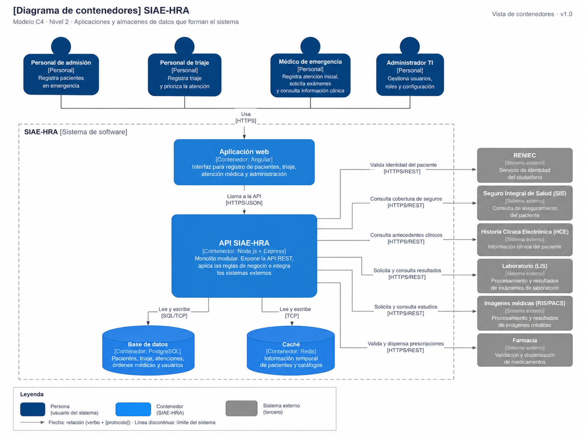

# Nivel 2 · Diagrama de contenedores

> **Proyecto:** SIAE-HRA — Sistema Integrado de Atención de Emergencias del Hospital Regional de Ayacucho  
> **Modelo:** C4 · Nivel 2 de 4 · **Versión:** 1.0

---

## 1. Objetivo

Abrir la caja **SIAE-HRA** del nivel 1 y mostrar los **contenedores** que componen el sistema: aplicaciones, almacenes de datos, tecnologías propuestas y sus comunicaciones durante la atención inicial de emergencias.

| **Aspecto** | **Descripción** |
|---|---|
| Pregunta que responde | ¿Qué aplicaciones y almacenes de datos conforman el sistema y cómo se comunican? |
| Audiencia | Arquitectos, desarrolladores, docentes y responsables de operaciones. |
| Qué es un contenedor | Una aplicación o almacén de datos desplegable de manera independiente; no equivale necesariamente a un contenedor Docker. |
| Nivel anterior | `Nivel1-DiagramadeContextodelSistema.md` |
| Siguiente nivel | `Nivel3-Diagrama-de-Componentes.md` |

---

## 2. Diagrama

---

## 3. Contenedores

| **Contenedor** | **Tecnología propuesta** | **Responsabilidad** | **Datos que maneja** |
|---|---|---|---|
| **Aplicación web** | SPA · Angular y TypeScript | Interfaz utilizada por admisión, enfermería, médicos y administración TI para la atención inicial. | Datos necesarios para la sesión y el episodio en pantalla; sin persistencia clínica local permanente. |
| **API SIAE-HRA** | Node.js + TypeScript + Express | Expone una API REST, aplica las reglas de negocio y coordina las integraciones. Se organiza como un **monolito modular**. | Procesa pacientes, triajes, evaluaciones, órdenes, usuarios y respuestas de los sistemas integrados. |
| **Base de datos** | PostgreSQL | Almacena los registros propios del sistema de manera persistente. | Pacientes, episodios de emergencia, triaje, evaluaciones, órdenes y usuarios. |
| **Caché** | Redis | Agiliza consultas repetitivas de información no clínica y temporal; no sustituye la base de datos. | Catálogos y configuraciones no sensibles, con vencimiento. |

---

## 4. Relaciones

| **Origen** | **Destino** | **Descripción** | **Protocolo o interfaz prevista** |
|---|---|---|---|
| Admisión, enfermería, médico y administrador TI | Aplicación web | Utilizan las funciones correspondientes a sus roles. | HTTPS |
| Aplicación web | API SIAE-HRA | Envía solicitudes y recibe respuestas. | HTTPS/JSON |
| API SIAE-HRA | PostgreSQL | Consulta y almacena información del sistema. | SQL/TCP |
| API SIAE-HRA | Redis | Consulta y actualiza datos temporales no sensibles. | TCP en red interna |
| API SIAE-HRA | RENIEC | Consulta datos de identificación del paciente. | Adaptador a servicio autorizado o simulado |
| API SIAE-HRA | Seguros / SIS | Consulta información de aseguramiento disponible. | Adaptador a servicio habilitado o simulado |
| API SIAE-HRA | Historia clínica electrónica | Solicita antecedentes clínicos pertinentes. | Adaptador de interoperabilidad, según sistema |
| API SIAE-HRA | Laboratorio (LIS) | Envía solicitudes de exámenes y consulta resultados. | API/adaptador, real o simulado |
| API SIAE-HRA | Imágenes médicas (RIS/PACS) | Solicita estudios y consulta informes. | API/adaptador, real o simulado |
| API SIAE-HRA | Farmacia | Consulta y gestiona información de prescripciones. | API/adaptador, real o simulado |

---

## 5. Decisiones arquitectónicas reflejadas

| **Decisión** | **Alternativa descartada** | **Motivo** |
|---|---|---|
| Un backend único organizado en módulos. | Microservicios independientes. | Reduce la complejidad de desarrollo y despliegue en el proyecto académico. |
| Frontend separado del backend. | Renderizar toda la interfaz en el servidor. | Permite separar presentación y reglas de negocio. |
| PostgreSQL para persistencia. | Base de datos exclusivamente NoSQL. | Permite almacenar datos relacionados y realizar operaciones transaccionales. |
| Redis para datos temporales no clínicos. | Consultar siempre la base de datos. | Puede reducir consultas repetitivas sin guardar historias clínicas en caché. |
| Integraciones externas mediante adaptadores del backend. | Acceso directo desde el navegador. | Separa proveedores y mantiene credenciales fuera del cliente. |
| Registro provisional de pacientes. | Exigir una respuesta de RENIEC antes del ingreso. | Permite continuar el flujo cuando faltan documentos o fallan los servicios externos. |

---

## 6. Seguridad entre contenedores

| **Comunicación** | **Medida** |
|---|---|
| Navegador → Aplicación web y API | Cifrado mediante HTTPS. |
| Aplicación web → API | Autenticación y autorización por roles en las operaciones protegidas. |
| API → PostgreSQL y Redis | Acceso restringido a la red interna y credenciales gestionadas en el servidor. |
| API → Sistemas integrados | Credenciales institucionales, cuando existan, y adaptadores sin secretos en el frontend. |
| Acceso a datos clínicos | Verificación de permisos y registro de auditoría. |
| Fallo de RENIEC o seguros | Permitir el registro provisional y la continuidad de la atención inicial. |
