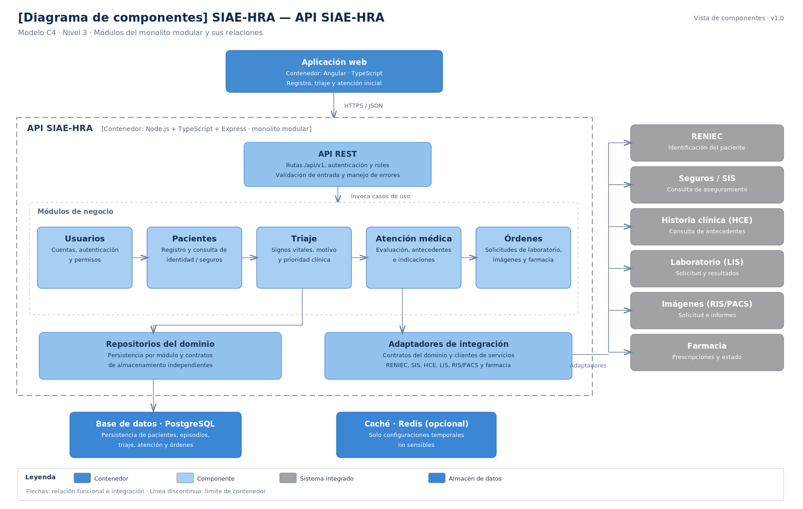

# Nivel 3 · Diagrama de componentes

> **Proyecto:** SIAE-HRA — Sistema Integrado de Atención de Emergencias del Hospital Regional de Ayacucho  
> **Contenedor detallado:** API SIAE-HRA  
> **Modelo:** C4 · Nivel 3 de 4 · **Versión:** 1.0

---

## 1. Objetivo

Abrir el contenedor **API SIAE-HRA** del nivel 2 y mostrar sus **componentes**: los módulos del monolito modular, la responsabilidad de cada uno y sus relaciones con los demás módulos, los almacenes de datos y los sistemas integrados durante la atención inicial de emergencias.

| **Aspecto** | **Descripción** |
|---|---|
| Pregunta que responde | ¿Cómo está dividido internamente el backend y qué hace cada módulo? |
| Audiencia | Arquitectos, desarrolladores y docentes. |
| Qué es un componente | Unidad funcional con una responsabilidad definida y una interfaz de acceso. En este diseño, cada módulo del monolito se representa como un componente. |
| Nivel anterior | `Nivel2-DiagramadeContenedores.md` |
| Siguiente nivel | `Nivel4-DiagramadeCodigo.md` |

---

## 2. Diagrama

---

## 3. Componentes

| **Componente** | **Responsabilidad** | **Funcionalidades principales** | **Carpeta propuesta en el código** |
|---|---|---|---|
| **API REST** | Punto de entrada HTTP del backend. | Rutas `/api/v1`, autenticación, autorización por roles, validación de datos y manejo de errores. | `src/api/` |
| **Usuarios** | Control de acceso al sistema. | Autenticación, cuentas y roles para admisión, enfermería, médicos y administrador TI. | `src/modules/usuarios/` |
| **Pacientes** | Identificación y registro inicial. | Búsqueda, registro provisional, consulta de identidad en RENIEC y consulta de aseguramiento. | `src/modules/pacientes/` |
| **Triaje** | Registro de la valoración inicial de enfermería. | Signos vitales, motivo de consulta y prioridad asignada por personal autorizado. | `src/modules/triaje/` |
| **Atención médica** | Registro de la evaluación inicial. | Consulta del episodio, antecedentes clínicos disponibles, evaluación e indicaciones médicas. | `src/modules/atencion/` |
| **Órdenes** | Gestión de solicitudes originadas en la atención. | Solicitudes de laboratorio, imágenes y prescripciones; consulta de sus estados y resultados disponibles. | `src/modules/ordenes/` |

---

## 4. Relaciones entre componentes

| **Origen** | **Destino** | **Descripción** | **Tipo de comunicación** |
|---|---|---|---|
| Aplicación web | API REST | Envía solicitudes del personal sanitario y administrativo. | HTTPS/JSON |
| API REST | Módulos de negocio | Invoca los casos de uso y verifica permisos. | Llamadas internas en memoria |
| Triaje | Pacientes | Obtiene los datos del paciente y su episodio de emergencia. | API pública del módulo, en memoria |
| Atención médica | Pacientes | Consulta la identificación y el episodio del paciente. | API pública del módulo, en memoria |
| Atención médica | Triaje | Consulta el registro de triaje y signos vitales. | API pública del módulo, en memoria |
| Órdenes | Atención médica | Asocia solicitudes de exámenes y prescripciones a la atención registrada. | API pública del módulo, en memoria |
| Módulos protegidos | Usuarios | Verifican la identidad y los permisos del usuario mediante los mecanismos de autorización de la API. | Servicio interno de autorización |

---

## 5. Relaciones con contenedores y sistemas integrados

| **Componente** | **Destino** | **Descripción** | **Interfaz propuesta** | **Patrón aplicado** |
|---|---|---|---|---|
| Cada módulo | Base de datos (PostgreSQL) | Lee y escribe exclusivamente sus datos mediante su propio repositorio. | SQL/TCP | Repositorio |
| Usuarios | Caché (Redis) | Consulta configuraciones temporales no sensibles cuando sea necesario. | TCP, red interna | Decorador (opcional) |
| Pacientes | RENIEC | Consulta identidad, cuando exista acceso autorizado. | Adaptador real o simulado | Adaptador |
| Pacientes | Seguros / SIS | Consulta información de aseguramiento sin bloquear el registro. | Adaptador real o simulado | Adaptador |
| Atención médica | Historia clínica electrónica (HCE) | Consulta antecedentes clínicos pertinentes, sujetos a autorización. | Adaptador de interoperabilidad | Adaptador |
| Órdenes | Laboratorio (LIS) | Solicita exámenes y consulta resultados. | API o servicio simulado | Adaptador |
| Órdenes | Imágenes médicas (RIS/PACS) | Solicita estudios y consulta informes disponibles. | API o servicio simulado | Adaptador |
| Órdenes | Farmacia | Comunica prescripciones y consulta estados disponibles. | API o servicio simulado | Adaptador |

---

## 6. Reglas del monolito modular

| **#** | **Regla** | **Motivo** |
|---|---|---|
| 1 | Todos los componentes del backend se despliegan juntos dentro de la API SIAE-HRA. | Mantener un monolito modular con un solo despliegue. |
| 2 | Un módulo se comunica con otro únicamente mediante su interfaz pública (`index.ts` o servicio expuesto). | Evitar dependencias directas de clases y archivos internos ajenos. |
| 3 | Cada módulo administra sus propios datos mediante repositorios; no modifica directamente las tablas de otro módulo. | Mantener límites funcionales claros. |
| 4 | Las conexiones con RENIEC, seguros, historia clínica y servicios hospitalarios se encapsulan en adaptadores. | Facilitar el reemplazo por APIs simuladas o autorizadas. |
| 5 | Cada módulo organiza su lógica con Arquitectura Limpia: presentación, aplicación, dominio e infraestructura. | Proteger las reglas de negocio frente a cambios de tecnología. |
| 6 | Si RENIEC o seguros no están disponibles, Pacientes permite el registro provisional y no bloquea la atención inicial. | Asegurar la continuidad del proceso de emergencia. |
| 7 | Las consultas clínicas exigen permisos y generan registros de auditoría. | Resguardar la información sensible y permitir trazabilidad. |
