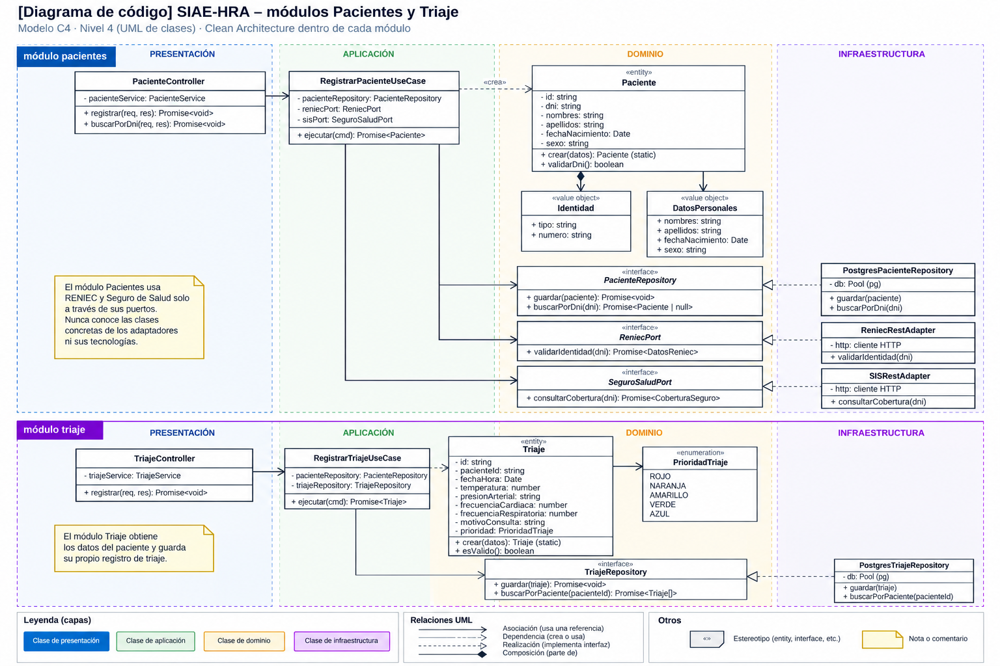
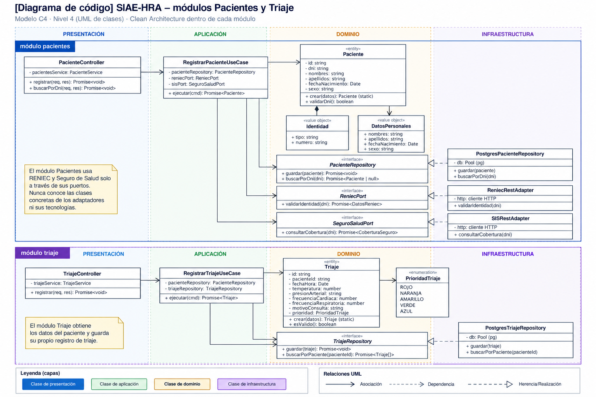

# Nivel 4 · Diagrama de código

> **Proyecto:** SIAE-HRA — Sistema Integrado de Atención de Emergencias del Hospital Regional de Ayacucho  
> **Módulos detallados:** Pacientes y Triaje  
> **Modelo:** C4 · Nivel 4 de 4 · **Notación:** UML · **Versión:** 1.0

---

## 1. Objetivo

Mostrar cómo está organizado el código de los componentes del nivel 3, identificando sus clases, interfaces y relaciones.

Se detalla el flujo **Registrar paciente y realizar triaje**, que involucra a los módulos Pacientes y Triaje, así como las integraciones propuestas con RENIEC, servicios de seguros y la base de datos PostgreSQL.

| **Aspecto** | **Descripción** |
|---|---|
| Pregunta que responde | ¿Qué clases existen dentro de los módulos y cómo se relacionan? |
| Audiencia | Arquitectos y desarrolladores. |
| Notación | UML: diagramas de clases y secuencia. |
| Por qué estos módulos | Pacientes y Triaje representan procesos fundamentales de la atención inicial de emergencias. |
| Nivel anterior | `Nivel3-Diagrama-de-Componentes.md` |

---

## 2. Diagrama de clases

### 2.1. Capas de Clean Architecture

| **Capa** | **Contiene** | **Regla** |
|---|---|---|
| Presentación | Controladores y rutas HTTP. | Recibe las solicitudes y devuelve las respuestas del sistema. |
| Aplicación | Casos de uso. | Coordina las operaciones de registro de pacientes y triaje sin depender de tecnologías concretas. |
| Dominio | Entidades, objetos de valor, enumeraciones e interfaces. | Contiene las reglas de negocio y no depende de las capas externas. |
| Infraestructura | Repositorios y adaptadores. | Implementa los contratos del dominio utilizando PostgreSQL y servicios externos. |

**Regla de dependencia:** las dependencias del código apuntan hacia el dominio. Los adaptadores de infraestructura implementan interfaces definidas en el dominio, evitando que las reglas de negocio dependan directamente de RENIEC, seguros o PostgreSQL.

### 2.2. Clases del módulo Pacientes

| **Clase** | **Tipo** | **Capa** | **Responsabilidad** |
|---|---|---|---|
| PacienteController | Controlador | Presentación | Recibe solicitudes de registro y consulta de pacientes. |
| RegistrarPacienteUseCase | Caso de uso | Aplicación | Coordina el registro, la consulta de identidad y la información de seguros. |
| Paciente | Entidad | Dominio | Representa al paciente y valida sus datos de registro. |
| Identidad | Objeto de valor | Dominio | Representa el tipo y número de documento disponible. |
| DatosPersonales | Objeto de valor | Dominio | Contiene nombres, apellidos y otros datos de identificación. |
| PacienteRepository | Interfaz | Dominio | Define las operaciones para guardar y buscar pacientes. |
| ReniecPort | Interfaz | Dominio | Define el contrato para consultar datos de identidad. |
| SeguroSaludPort | Interfaz | Dominio | Define el contrato para consultar información de aseguramiento. |
| PostgresPacienteRepository | Repositorio | Infraestructura | Implementa la persistencia de pacientes en PostgreSQL. |
| ReniecRestAdapter | Adaptador | Infraestructura | Implementa ReniecPort mediante el servicio de identidad autorizado o simulado. |
| SISRestAdapter | Adaptador | Infraestructura | Implementa SeguroSaludPort para consultar información de aseguramiento. |

### 2.3. Clases del módulo Triaje

| **Clase** | **Tipo** | **Capa** | **Responsabilidad** |
|---|---|---|---|
| TriajeController | Controlador | Presentación | Recibe solicitudes de registro del triaje. |
| RegistrarTriajeUseCase | Caso de uso | Aplicación | Verifica la existencia del paciente y coordina el registro del triaje. |
| Triaje | Entidad | Dominio | Almacena los signos vitales, motivo de consulta y prioridad registrada. |
| PrioridadTriaje | Enumeración | Dominio | Representa las categorías de prioridad definidas para el sistema. |
| TriajeRepository | Interfaz | Dominio | Define las operaciones de persistencia y consulta del triaje. |
| PostgresTriajeRepository | Repositorio | Infraestructura | Guarda y consulta los registros de triaje en PostgreSQL. |

El módulo Triaje obtiene la información necesaria del módulo Pacientes mediante su interfaz pública, sin acceder directamente a sus tablas.

La prioridad de triaje es asignada por el personal de enfermería autorizado, conforme al protocolo de clasificación que se adopte en el proyecto.

### 2.4. Notación UML utilizada

| **Símbolo** | **Significado** | **Ejemplo** |
|---|---|---|
| Línea continua con flecha abierta | Asociación entre clases. | RegistrarPacienteUseCase → PacienteRepository |
| Línea discontinua con flecha abierta | Dependencia o creación de objetos. | RegistrarPacienteUseCase → Paciente |
| Línea discontinua con triángulo hueco | Implementación de una interfaz. | ReniecRestAdapter → ReniecPort |
| Rombo relleno | Composición entre objetos. | Paciente ◆ Identidad |
| «interface» | Contrato sin implementación concreta. | PacienteRepository |
| «entity» | Entidad del dominio. | Paciente, Triaje |
| «enumeration» | Conjunto de valores definidos. | PrioridadTriaje |
| - / + | Miembro privado / público. | - id, + crear() |

---

## 3. Diagrama de secuencia: registrar paciente y realizar triaje

El diagrama representa el proceso de atención inicial, desde el registro del paciente hasta el almacenamiento de su triaje.

### 3.1. Flujo de registro de paciente

| **Paso** | **Origen → Destino** | **Acción** |
|---|---|---|
| 1 | Personal de admisión → PacienteController | Envía POST `/api/v1/pacientes` con los datos disponibles y credenciales de sesión. |
| 2 | PacienteController → RegistrarPacienteUseCase | Ejecuta el caso de uso de registro. |
| 3 | RegistrarPacienteUseCase → PacienteRepository | Comprueba si ya existe un registro asociado al documento, cuando esté disponible. |
| 4 | RegistrarPacienteUseCase → ReniecPort | Solicita información de identidad si existe un DNI válido. |
| 5 | ReniecRestAdapter → RENIEC | Realiza la consulta mediante el servicio autorizado o simulado. |
| 6 | RegistrarPacienteUseCase → SeguroSaludPort | Consulta información de aseguramiento cuando corresponda. |
| 7 | SISRestAdapter → Servicio de seguros | Obtiene la información de aseguramiento disponible. |
| 8 | RegistrarPacienteUseCase → Paciente | Crea la entidad utilizando los datos disponibles. |
| 9 | RegistrarPacienteUseCase → PacienteRepository | Solicita guardar el paciente. |
| 10 | PostgresPacienteRepository → PostgreSQL | Registra los datos del paciente. |
| 11 | PacienteController → Aplicación web | Responde `201 Created` con el identificador del paciente nuevo. |

Si el paciente ya se encuentra registrado, el sistema devuelve su identificador existente para continuar la atención, evitando duplicados innecesarios.

### 3.2. Flujo de registro de triaje

| **Paso** | **Origen → Destino** | **Acción** |
|---|---|---|
| 12 | Personal de enfermería → TriajeController | Envía POST `/api/v1/triaje` con el identificador del paciente, signos vitales y prioridad asignada. |
| 13 | TriajeController → RegistrarTriajeUseCase | Ejecuta el caso de uso de registro de triaje. |
| 14 | RegistrarTriajeUseCase → Módulo Pacientes | Verifica que el paciente exista mediante la interfaz pública del módulo. |
| 15 | RegistrarTriajeUseCase → Triaje | Crea la entidad con los signos vitales, el motivo de consulta y la prioridad registrada. |
| 16 | RegistrarTriajeUseCase → TriajeRepository | Solicita guardar el registro de triaje. |
| 17 | PostgresTriajeRepository → PostgreSQL | Almacena el triaje asociado al paciente y al episodio de emergencia. |
| 18 | TriajeController → Aplicación web | Responde `201 Created` con el identificador del registro de triaje. |

### 3.3. Flujo alternativo: RENIEC no disponible

Cuando RENIEC no responde o el paciente no presenta un documento de identidad:

1. El personal de admisión registra los datos disponibles.
2. El sistema crea un registro provisional con un identificador interno.
3. Se guarda la información del paciente en PostgreSQL.
4. El paciente puede continuar hacia triaje sin esperar la respuesta de RENIEC.
5. La identidad podrá completarse posteriormente.

La ausencia de información de seguros tampoco debe impedir el registro ni la atención inicial de emergencia.

---

## 4. Patrones y principios aplicados

| **Elemento del diagrama** | **Patrón o principio** |
|---|---|
| ReniecRestAdapter y SISRestAdapter | Patrón Adaptador: permite integrar servicios externos sin acoplar las reglas del negocio a sus APIs. |
| PacienteRepository y PostgresPacienteRepository | Patrón Repositorio: separa el dominio de las operaciones SQL. |
| TriajeRepository y PostgresTriajeRepository | Patrón Repositorio aplicado al almacenamiento de triaje. |
| Los casos de uso reciben interfaces en lugar de implementaciones concretas. | Principio de inversión de dependencias (SOLID). |
| Cada controlador, entidad, caso de uso y repositorio tiene una responsabilidad definida. | Principio de responsabilidad única (SOLID). |
| Triaje consulta la información de Pacientes mediante una interfaz pública. | Regla del monolito modular: comunicación entre módulos mediante contratos definidos. |
| La integración RENIEC puede reemplazarse por un adaptador simulado. | Principios abierto/cerrado y sustitución de Liskov. |

Los patrones y principios se detallan en:

- `../03-diseño-de-software/diseño-interno/patrones-de-diseño.md`
- `../03-diseño-de-software/diseño-interno/principios-de-diseño.md`

La documentación representa el diseño arquitectónico propuesto para la Fase 1 del SIAE-HRA.
