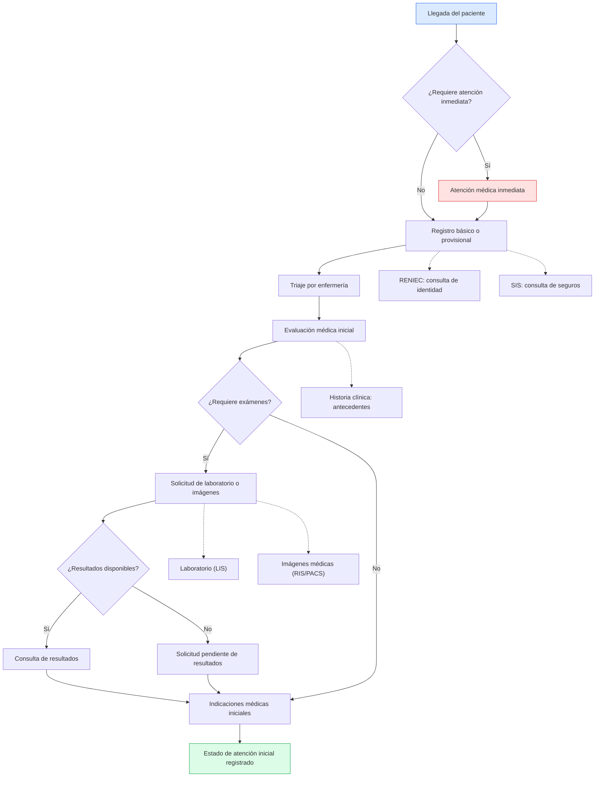

# 03. Flujo de atención inicial

## Objetivo

Describir el proceso de atención inicial de emergencias del SIAE-HRA, desde el ingreso del paciente hasta el registro de la evaluación médica inicial, incluyendo las consultas a sistemas externos y hospitalarios.

## Diagrama de flujo

## Descripción del proceso

| **Etapa** | **Responsable** | **Actividad** |
|---|---|---|
| 1. Ingreso | Admisión / Personal de emergencia | Identifica el ingreso del paciente y prioriza la atención inmediata cuando sea necesaria. |
| 2. Registro | Admisión | Registra los datos personales o crea un registro provisional. |
| 3. Triaje | Enfermería | Registra signos vitales, motivo de consulta y prioridad de atención. |
| 4. Evaluación inicial | Médico de emergencia | Consulta antecedentes disponibles y registra la evaluación médica. |
| 5. Solicitud de exámenes | Médico de emergencia | Solicita análisis de laboratorio o estudios de imágenes cuando corresponda. |
| 6. Resultados | Médico de emergencia | Consulta los resultados disponibles y mantiene el seguimiento de solicitudes pendientes. |
| 7. Indicaciones | Médico de emergencia | Registra las indicaciones y prescripciones iniciales. |
| 8. Registro del estado | Sistema SIAE-HRA | Actualiza el estado de la atención inicial del paciente. |

## Consultas de apoyo

| **Sistema** | **Información consultada** | **Etapa** |
|---|---|---|
| RENIEC | Identificación y datos personales del paciente. | Registro |
| SIS / Seguros | Afiliación y estado de aseguramiento. | Registro |
| Historia clínica electrónica | Antecedentes, alergias, diagnósticos y medicamentos disponibles. | Evaluación médica |
| Laboratorio (LIS) | Solicitudes y resultados de análisis clínicos. | Exámenes |
| Imágenes médicas (RIS/PACS) | Solicitudes, informes y estudios de diagnóstico. | Exámenes |
| Farmacia | Disponibilidad y estado de las prescripciones iniciales. | Indicaciones médicas |

Las consultas de apoyo se realizan mediante APIs o adaptadores cuando los servicios están disponibles. **La falta de identificación, seguro o conexión con sistemas externos no debe retrasar la atención de emergencia.**
